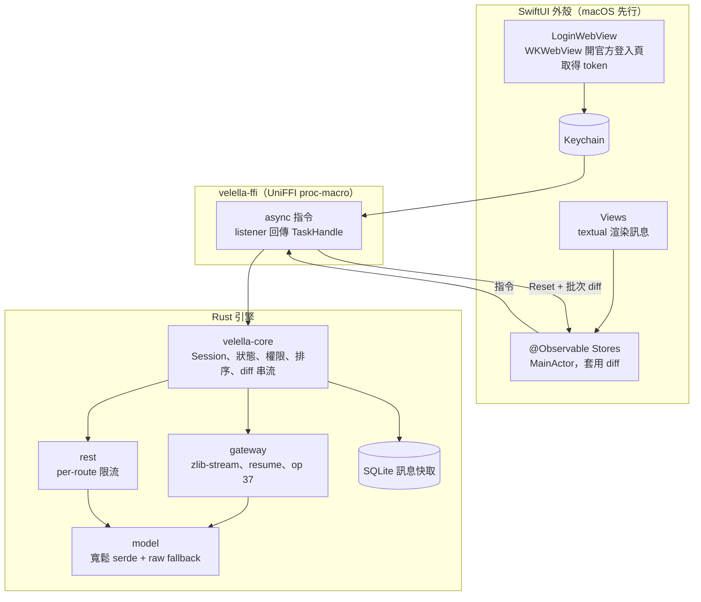

# 參考專案分析：Rust 引擎 + SwiftUI Discord client

## 目錄

- [文件目的](#文件目的)
- [參考專案總覽](#參考專案總覽)
- [授權：決定哪些程式碼能直接拿](#授權決定哪些程式碼能直接拿)
- [Gateway 與 REST](#gateway-與-rest)
- [登入與 token 保存](#登入與-token-保存)
- [狀態、快取與已讀](#狀態快取與已讀)
- [引擎與 UI 的邊界（FFI 形狀）](#引擎與-ui-的邊界ffi-形狀)
- [UI 層：Swiftcord 能參考什麼](#ui-層swiftcord-能參考什麼)
- [語音（後期）](#語音後期)
- [建議架構](#建議架構)
- [待決策事項](#待決策事項)
- [關鍵程式碼索引](#關鍵程式碼索引)

---

## 文件目的

velella 的目標是做一個 user account 用的 Discord client：Rust 引擎負責 gateway、REST、狀態與快取，SwiftUI 外殼負責畫面，兩者透過 FFI 溝通，先做 macOS。這份文件整理 2026-10-13 對 13 個參考專案的唯讀分析（只讀程式碼，沒有 build、沒有連線到 Discord），目的是在寫第一行程式碼之前，先決定哪些東西可以借、該向誰借，以及哪些坑別人已經踩過。

所有參考專案以 shallow clone 的形式放在 `refs/`（已加入 `.git/info/exclude`，不進版控）。文中的 `file:line` 都相對於 `refs/<repo>/`，更新參考專案用：

```bash
git -C refs/<repo> pull --depth 1
```

> **注意：** 以下關於協定行為的描述都來自閱讀程式碼，沒有一項實際對 Discord 驗證過。「Discord 會接受 X」這類說法一律視為未驗證。

---

## 參考專案總覽

| Repo | 語言 / UI | 授權 | 最後更新 | 對 velella 的價值 |
|---|---|---|---|---|
| `swiftcord-legacy` | Swift / SwiftUI | GPL-3.0 | 2024-05 | UI 結構可參考，但大量 stub，見 [UI 層](#ui-層swiftcord-能參考什麼) |
| `discordkit` | Swift | **沒有 LICENSE 檔** | 2026-09 | 只能參考欄位與協定細節，不能複製 |
| `textual-swiftcord` | Swift / SwiftUI | MIT | 2026-08 | **可直接當相依套件**：Swiftcord 維護者 fork 的富文本引擎，領先上游 14 個效能修正 commit |
| `serein` | Rust / egui | MIT OR Apache-2.0 | 2026-10 | **引擎程式碼最能直接借用**：gateway 狀態機、op 37 成員列表、SQLite、REST 防護 |
| `concord` | Rust / ratatui | GPL-3.0-only | 2026-10 | 最完整、測試最多（約 1,866 個 test），引擎與 UI 完全分離；GPL 限制複製 |
| `scope` | Rust / gpui | AGPL-3.0-or-later | 2026-08 | `Backend` trait + 離線 demo backend 的概念值得學 |
| `oxicord` | Rust / ratatui | LICENSE 寫 GPL-3.0，Cargo.toml 寫 MIT（互相矛盾） | 2026-05 | 價值低；README 的「O(1) message geometry」與程式碼不符 |
| `discord-client-rs` | Rust | **沒有 LICENSE 檔** | 2026-09 | 主打 TLS 偽裝與反偵測，只能看欄位名稱 |
| `vimcord` | Rust / ratatui | MIT | 2026-08 | 價值低：gateway 沒有 resume、沒有壓縮 |
| `twilight` | Rust | ISC | 2026-10 | 為 bot 設計，gateway 強制加 `Bot ` 前綴，model 沒有 user 事件 |
| `songbird` / `davey` | Rust | ISC / MIT | 2026-10 | 語音與 DAVE E2EE，後期才需要 |
| `matrix-rust-sdk` + `element-x-ios` | Rust + SwiftUI | Apache-2.0 / AGPL-3.0 | 2026-10 | **FFI 架構範本**：正是「Rust 聊天 SDK 透過 UniFFI 接 SwiftUI」的正式產品 |

charliie 試過的三個 Rust 專案裡，Serein 是唯一值得深入的；discord-client-rs 沒有授權而且偏向反偵測，vimcord 太陽春。

> **注意：** Swiftcord 目前的預設分支 `v2`（Liquid Glass、macOS 26+、支援 Voice 與 Video）**是閉源的**，repo 只剩 README。swiftcord.app 雖然寫著「open source development」，公開的程式碼其實只有 `main` 分支上 2023 年的 v0.7.1。UI 外觀要以 v2 實際畫出來的畫面為準，舊版程式碼只能參考寫法。

Serein 本身也有一點要留意：它在 2026-09 才建立，自己的文件寫著 user account 的 Identify 還沒經過實際連線驗證（`crates/discord-gateway/src/lib.rs:1`、`docs/authentication.md:64`）。Concord 從 2026-05 就開始開發，已經進了 Homebrew 與 nixpkgs，實戰證據比較多。

---

## 授權：決定哪些程式碼能直接拿

velella 自己用什麼授權，決定了能從哪些專案複製程式碼。這是第一個要做的決定。

| velella 採用的授權 | 可以複製或改寫的來源 | 只能讀、不能複製 |
|---|---|---|
| MIT / Apache（寬鬆） | serein、textual、vimcord、twilight、songbird、davey、matrix-rust-sdk | swiftcord-legacy、concord、scope、oxicord、element-x-ios、discordkit、discord-client-rs |
| GPL-3.0 | 上面全部，再加上 swiftcord-legacy、concord | scope、element-x-ios（AGPL）、discordkit、discord-client-rs |
| AGPL-3.0 | 上面全部，再加上 scope、element-x-ios | discordkit、discord-client-rs |

> ⚠️ **警告：** DiscordKit 與 discord-client-rs 都沒有 LICENSE 檔（已親自確認），在法律上等於保留所有權利。不管 velella 採用什麼授權，都不能複製這兩個專案的程式碼。

Serein 也不是整包都是 MIT/Apache：通知音效的再散布權未定、Twemoji 是 CC BY 4.0、vendored 的 `hpke-rs` 是 MPL-2.0（見 `THIRD_PARTY_NOTICES.md:67-151`）。

---

## Gateway 與 REST

所有能用的 Rust client 都**自己寫 Discord 協定層**，沒有一個用 twilight 或 serenity 來跑 user account（scope 用了 serenity fork，結果拿不到 `read_state`）。原因在 twilight 身上看得很清楚：`ConfigBuilder::new` 會強制在 token 前面加上 `Bot `（`twilight-gateway/src/config.rs:169-172`，已確認），IdentifyInfo 沒有 `client_state` 欄位，`DispatchEvent` 是封閉的 enum，READY_SUPPLEMENTAL、MESSAGE_ACK、GUILD_MEMBER_LIST_UPDATE 這些 user 才會收到的事件一個都沒有。

| 項目 | Serein | Concord | DiscordKit（Swiftcord） |
|---|---|---|---|
| Gateway URL | `v=10&compress=zlib-stream` | `v=9&compress=zlib-stream` | `v=9&compress=zlib-stream` |
| Identify `capabilities` | 不送 | `253` | `1734653` |
| Identify `client_state` | 不送 | 送（記憶體內） | `{guild_versions:{}}` |
| Heartbeat | op 1，漏 ACK 就重連 | op 1 | op 40（QoS），網路變化或喚醒時會提前送 |
| Resume | close code 分類 + 失敗 3 次重置 | resume_url、session、seq 齊全才 resume | 最後一次 ACK 在 3 分鐘內才 resume |
| 成員列表訂閱 | op 37，range 有驗證 | op 37 + op 8 | op 14 |
| REST rate limit | 4 個 permit + 全域共用 cooldown | 依 route bucket 限流 + forbidden 斷路器 | 沒有，429 直接丟錯 |
| TLS | 標準 rustls | 標準 rustls | URLSession |
| 測試 | 約 1,360 個 | 約 1,866 個 | 21 個測試檔 |

結論是協定層自己寫，模型（model）用寬鬆的 serde 搭配 raw `Value` fallback：遇到不認得的事件就保留原始 JSON，不讓整條連線失敗。gateway 狀態機以 Serein 的 `discord-gateway` 為藍本（授權允許複製），再補上 Concord 有、Serein 缺的 `capabilities` 與 `client_state`。REST 限流則參考 Concord 的 per-route bucket 寫法。

> ⚠️ **警告：** 用 user token 跑第三方 client 違反 Discord ToS，帳號有被停權的風險，Swiftcord、Serein、Concord 全都一樣。開發與測試建議用分身帳號。三個主流專案都用標準 TLS，只把 super properties 做成跟瀏覽器一致；discord-client-rs 那種 TLS 指紋偽裝與 Cloudflare clearance 繞過不需要，也不建議跟進。

---

## 登入與 token 保存

| 專案 | 登入方式 | Token 保存 |
|---|---|---|
| Swiftcord | WKWebView 開 `discord.com/login`，用 JS shim 攔截 `localStorage` 裡的 token | Keychain，但所有帳號塞在同一個 JSON blob |
| Serein | 無痕 webview 開官方登入頁，hook `fetch` / XHR 的 Authorization header | 系統 keystore，每個帳號一筆，不 fallback 到明文 |
| Concord | 原生實作：email + 密碼、TOTP / SMS MFA、QR remote auth（RSA-2048） | Keychain，失敗時 fallback 到 0600 明文檔 |
| scope | 只能貼 token | 明文檔 0600 |

用 WebView 開官方登入頁是 Swiftcord 和 Serein 共同的選擇，好處是 captcha、MFA、QR 登入全部交給 Discord 自己的頁面處理，velella 不用維護。macOS 上就是 WKWebView 拿 token、存進 Keychain，再把 token 交給 Rust。Concord 的原生 QR 登入（`src/discord/qr_auth.rs`）可以留到之後做 iOS 時再參考。

---

## 狀態、快取與已讀

| 項目 | Serein | Concord |
|---|---|---|
| 記憶體快取 | 一條 timeline 500 則 / 4 MiB | 每個頻道 200 則，最多 10 個熱頻道，Arc copy-on-write |
| 持久化 | SQLite（rusqlite bundled，WAL，64 MiB 上限，依帳號隔離） | 不存訊息 |
| 歷史分頁 | `before` / `after` / `around`，limit 50 | 同左 |
| 已讀 | READY 的 `read_state` + MESSAGE_ACK + REST ack | 同左，加上 mention 計數 |
| 權限計算 | `crates/model/src/permissions.rs:229-299` | `src/discord/permission.rs:454-513`，資料不足時回 `Unavailable` 而不是用猜的 |

Concord 在權限資料不足時回傳 `Unavailable`，不會猜一個值；velella 應該照這個原則做，不然頻道清單會在資料還沒到齊時誤藏頻道。

---

## 引擎與 UI 的邊界（FFI 形狀）

參考專案裡看得到四種邊界設計：

| 模式 | 出處 | 怎麼運作 | 適合 FFI 嗎 |
|---|---|---|---|
| 粗粒度通知 + 同步讀取 | scope `ClientEvent` | 引擎只發「guilds 變了」，UI 再用 getter 讀快照 | 適合純量與小資料；長列表每次全量重讀太浪費 |
| Effects 佇列 + revision + 快照 | concord `take_effects` + `watch` | mpsc 送事件，watch 送版本號，Arc COW 快照 | 適合，但要自己定義 diff |
| Command 進 / Event 出 | serein `Command` / `Event` / `Envelope{generation}` | 單一 UI 執行緒擁有狀態 | 適合；generation 可以丟棄舊連線的事件 |
| Listener + VectorDiff 串流 | matrix-rust-sdk | 訂閱時先送一次 `Reset`，之後批次送 diff，回傳 `Arc<TaskHandle>` | **最適合 SwiftUI 的長列表** |

你自己的 TokenBar-Native 用的是手寫 C ABI staticlib、JSON envelope `{ok,data,err}` 加上 `catch_unwind`。那是 pull 模型，適合「Swift 問、Rust 答」。聊天 client 主要是 push：gateway 事件不斷進來，要主動推給 Swift。UniFFI 0.32 原生支援 async 函式和 callback interface，matrix-rust-sdk 已經在正式產品上驗證過這條路。

從 matrix-rust-sdk 和 Element X 值得照抄的做法：

| 做法 | 出處 |
|---|---|
| listener 回傳 `Arc<TaskHandle>`，drop 時自動取消 | `bindings/matrix-sdk-ffi/src/task_handle.rs:22-53` |
| 訂閱時先送完整 `Reset`，之後才送批次 diff | `bindings/matrix-sdk-ffi/src/timeline/mod.rs:338-360` |
| 過濾與排序放在 Rust（dynamic adapters），Swift 只設 filter | `crates/matrix-sdk-ui/src/room_list_service/room_list.rs:140-194` |
| Swift 端：每個 listener 一條 AsyncStream，在 MainActor 上單一 consumer | `element-x-ios/ElementX/Sources/Other/SDKListener.swift:34-51` |
| proxy 物件持有所有 TaskHandle | `element-x-ios/ElementX/Sources/Services/Client/ClientProxy.swift:27-55` |
| 呼叫 callback 前先把 delegate 從 lock 裡複製出來，避免 re-entrancy deadlock | `bindings/matrix-sdk-ffi/src/session_verification.rs:371-379` |
| Client 包在 `AsyncRuntimeDropped`，避免在非 tokio 執行緒 drop 時 SIGABRT | `bindings/matrix-sdk-ffi/src/utils.rs:40-65` |
| build：每個 target 跑 cargo、lipo、產生 Swift binding、`xcodebuild -create-xcframework` | `xtask/src/swift.rs:398-474`、`:598`、`:346-356` |

對單人專案來說過度的部分：獨立的 components repo、每個型別都配 proxy + Sourcery mock、watchOS tier-3 build、UDL（直接用 proc-macro 就好）。

---

## UI 層：Swiftcord 能參考什麼

舊版 Swiftcord 的畫面結構可以參考，但完成度比印象中低很多：

| 區塊 | 舊版 Swiftcord 的狀態 |
|---|---|
| 主畫面 | HStack：伺服器欄 + `NavigationView`，沒有用 NavigationSplitView |
| 訊息列表 | SwiftUI `List` 透過 Introspect 把 NSScrollView 旋轉 180°，每列再翻回來 |
| Markdown | 只用 Foundation `AttributedString(markdown:)` 的 inline 模式 |
| Mention、自訂 emoji、spoiler、code block、reaction | **都沒有渲染**，直接顯示原始內容 |
| 成員列表、好友列表 | 沒有 |
| 新增 reaction、建立 thread、釘選、編輯 | 只是 `print` stub |
| 送出訊息 | 只走 REST，沒有 optimistic insert |
| 分頁 | 新訊息插在 index 0，分頁時 append 卻沒有去重，會有 race |

所以 v2 的完整度都在閉源的部分，舊版程式碼能提供的主要是檔案組織和幾個元件（embed、附件、貼圖、系統訊息）的寫法。

兩條比較有用的線索：

| 線索 | 意義 |
|---|---|
| Swiftcord 維護者 fork 了 `gonzalezreal/textual`（MIT），2026-06 到 08 推了快取、跳過 emoji 解析、同步首次渲染、關閉 link overlay 等效能修正 | v2 的訊息富文本幾乎可以確定建在 textual 上。velella 可以直接依賴這個 fork，用它的 `MarkupParser` protocol 接 Discord markdown（`<@id>`、`<#id>`、`<:name:id>`、`<t:...>`、spoiler） |
| Element X 把 timeline 從 SwiftUI 改成翻轉的 UITableView + UIHostingConfiguration，理由是「分頁時插入項目會讓捲動跳動」（`TimelineTableViewController.swift:63-95`、`CHANGES.md:4989`） | 訊息列表是 UI 層最大的技術風險。macOS 上對應的選擇是 SwiftUI `ScrollView` + `LazyVStack` + `defaultScrollAnchor(.bottom)`，或 NSTableView。要先做 spike 決定 |

---

## 語音（後期）

| 選項 | 現況 |
|---|---|
| songbird `Driver` 單獨使用 | 可以餵自己 gateway 拿到的 `ConnectionInfo`，支援 DAVE 收發；但 `guild_id` 必填（`src/info.rs:111`，已確認），DM / 群組通話塞不進去，也不包含音訊裝置 I/O |
| 學 Concord / Serein 自己寫 | 兩者都自己寫 voice gateway 與 RTP，直接用 davey 處理 DAVE，音訊裝置用 cpal，macOS 螢幕分享用 ScreenCaptureKit |

> **注意：** Serein 的 `discord-voice` 依賴 `platform` crate，會一路拉進 winit、wry（`crates/discord-voice/Cargo.toml:10`，已確認），不能整包拿來當 velella 的相依套件。davey 目前沒有獨立的密碼學稽核（`serein/vendor/davey/SEREIN-PATCH.md:15`）。

---

## 建議架構



Rust 負責所有「資料怎麼變成列表」的邏輯：排序伺服器資料夾、依權限過濾頻道、訊息分組與日期分隔。Swift 只負責把 diff 套到 `@Observable` 狀態上並畫出來。之後做 iOS 時，整個 Rust 層都能直接沿用。

---

## 待決策事項

| # | 決策 | 選項 | 建議 |
|---|---|---|---|
| 1 | velella 的授權 | MIT/Apache、GPL-3.0、AGPL-3.0 | 取決於想不想直接用 Concord 的程式碼。用 GPL-3.0 就能同時借 Concord 與 Swiftcord 舊版 |
| 2 | FFI 技術 | UniFFI，或沿用 TokenBar 的 C ABI + JSON | UniFFI：聊天 client 需要 push 與 async，手寫 C ABI 要自己處理所有型別與 callback |
| 3 | macOS 最低版本 | macOS 26+（跟 Swiftcord v2 一樣用 Liquid Glass），或更早 | macOS 26+：只鎖一個版本，新的 SwiftUI 捲動 API 也都能用 |
| 4 | 訊息列表實作 | SwiftUI `LazyVStack`，或 NSTableView | 先做 spike，用真實頻道測分頁時捲動會不會跳 |

---

## 關鍵程式碼索引

| 主題 | 位置 |
|---|---|
| Gateway 狀態機（ResumeState、close code 分類、heartbeat、backoff） | `serein/crates/discord-gateway/src/lib.rs:58-70`、`:138-199`、`:1182-1196` |
| zlib-stream 解壓縮（suffix 偵測 + 64 MiB 上限） | `serein/crates/discord-gateway/src/compression.rs:20-73` |
| READY / READY_SUPPLEMENTAL 合併 merged_members | `serein/crates/discord-gateway/src/lib.rs:1598-1715` |
| op 37 成員列表訂閱與 range 驗證 | `serein/crates/discord-gateway/src/lib.rs:338-381` |
| REST 防護（固定 origin、路徑驗證、寫入不重試） | `serein/crates/discord-api/src/lib.rs:181-184`、`:335-341`、`:401-406` |
| SQLite pragma 與 migration | `serein/crates/local-store/src/lib.rs:285-326` |
| 登入 token handoff（webview） | `serein/crates/platform/src/login-handoff.js:15-38` |
| Token 型別（Zeroizing、遮蔽 Debug） | `serein/crates/client-core/src/auth.rs:74-100` |
| Identify capabilities bitfield 註解 | `concord/src/discord/gateway.rs:131-140`（GPL） |
| Resume 或重新 Identify 的判斷 | `concord/src/discord/gateway.rs:908-950`（GPL） |
| Per-route bucket 限流 | `concord/src/discord/rest.rs:449-560`（GPL） |
| QR remote auth | `concord/src/discord/qr_auth.rs`（GPL） |
| Client 產生 nonce 對應 pending 訊息 | `concord/src/discord/commands.rs:28-50`（GPL） |
| Demo backend（模擬延遲，可給 SwiftUI Preview 用） | `scope/src/demo/src/client.rs:166-187`、`channel.rs:20-23`（AGPL） |
| 分頁游標 `AsyncListIndex` | `scope/src/chat/src/async_list.rs:44-68`（AGPL） |
| DiscordKit identify 與 heartbeat | `discordkit/Sources/DiscordKitCore/Gateway/RobustWebSocket.swift:229-233`、`:819-908`（無授權，只能讀） |
| Swiftcord 訊息列表 | `swiftcord-legacy/Swiftcord/Views/Message/MessagesView.swift:206-243`（GPL） |
| Swiftcord embed / 附件 | `swiftcord-legacy/Swiftcord/Views/Message/EmbedView.swift`、`Views/Message/Attachment/AttachmentView.swift`（GPL） |
| songbird 單獨使用 Driver | `songbird/src/info.rs:102-118`、`src/driver/mod.rs:97-128` |
